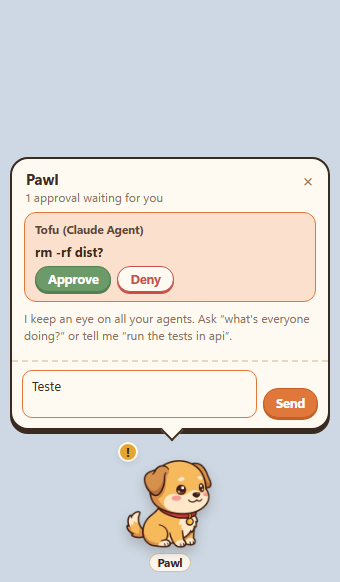
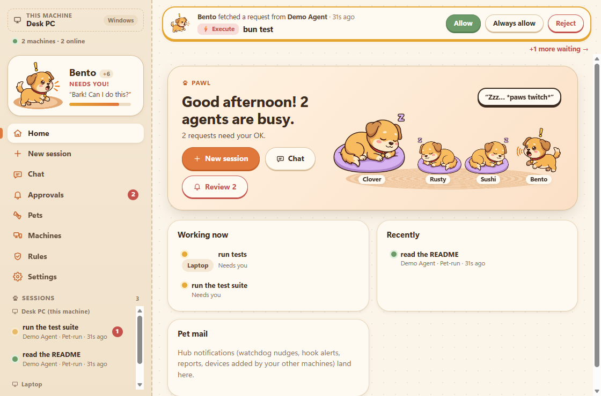
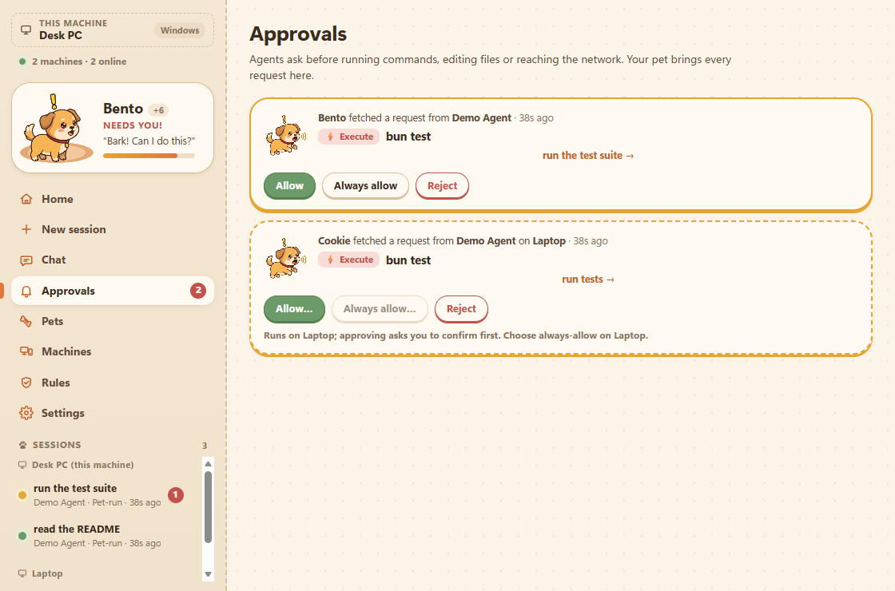
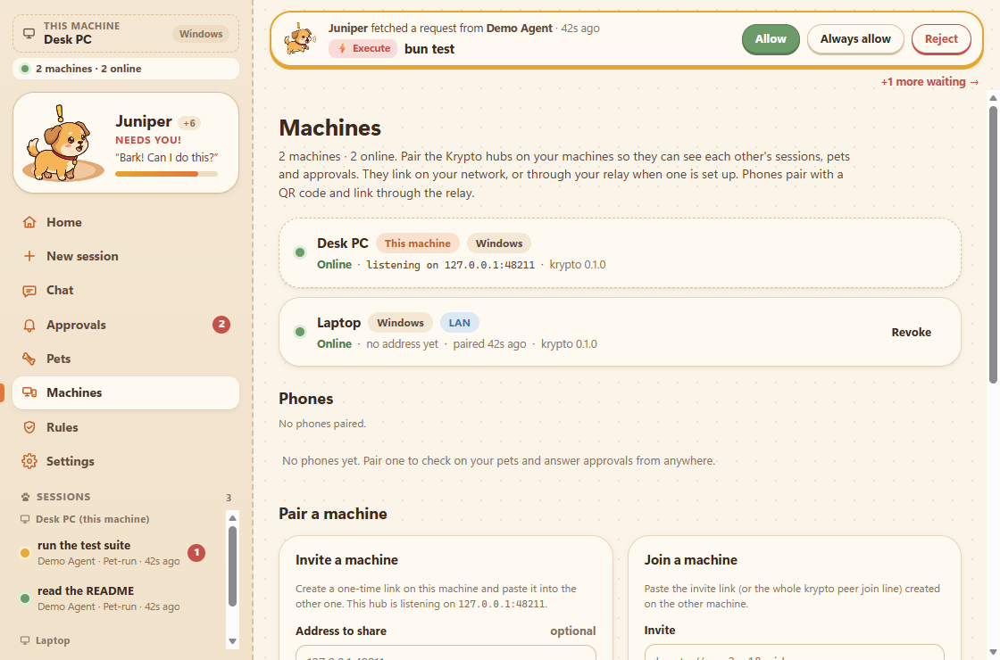
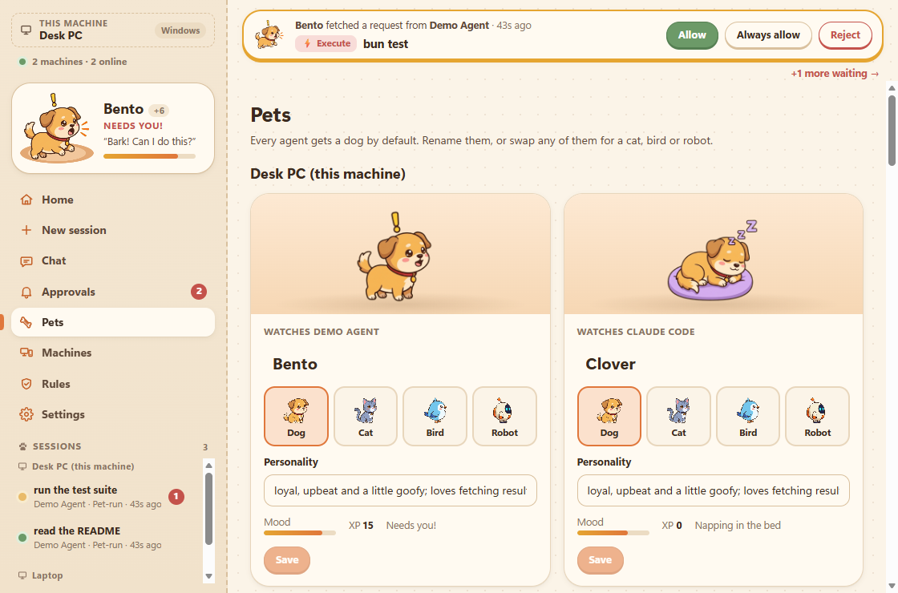
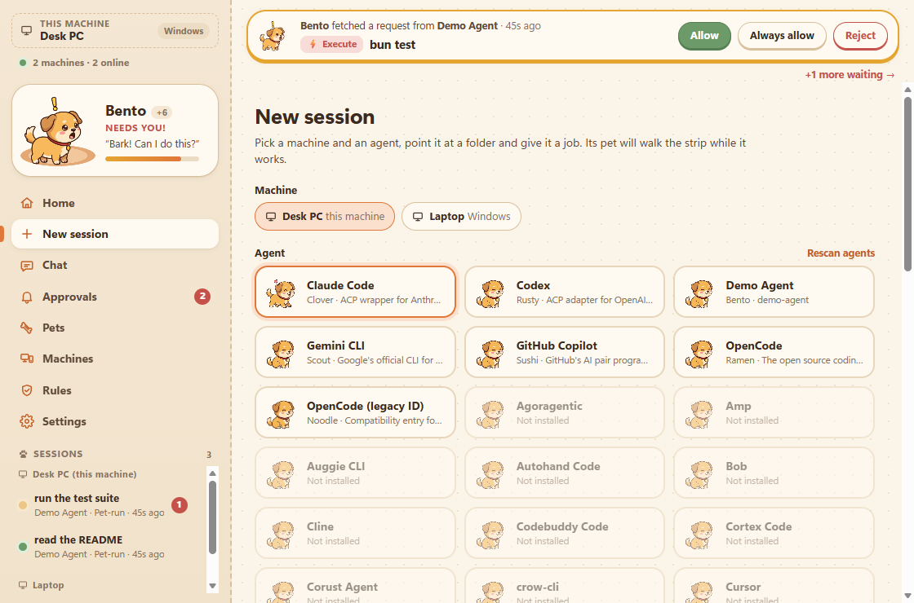
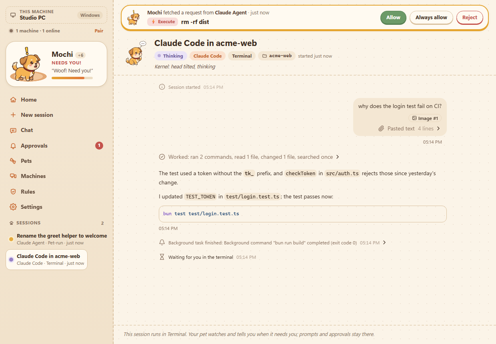

# Pawl

Named dog pets that watch and drive your coding agents over ACP ([Agent Client Protocol](https://agentclientprotocol.com/)).

**Website:** https://sunderbharath85.github.io/pawl/ · **Download:** [latest release](https://github.com/sunderbharath85/pawl/releases)



*One pet sits wherever you drag it on your screen. Click it to open its chat bubble: approvals waiting for you come first, and you can ask it anything about your agents in plain words. It stays still until you talk to it.*

## What it is

Pawl runs one **hub** per machine. The hub connects to the coding agents installed on that machine (Claude Code, Codex, Gemini CLI and others) and tracks every session it can see. Each agent gets a pet, a dog by default, with a name.

One default pet, with its own name, orchestrates all of them: ask it what is going on, approve or deny requests, or tell it to start or prompt an agent. Anything it would start or send comes back as a card you confirm. It can use a language model to understand any wording: your Claude Code (no API key, on your Claude plan, with every tool turned off), or Anthropic, OpenAI, Gemini or Ollama.

You see the pets in three places:

- **Desktop pet:** a Tauri app with one pet you can drag anywhere and a chat bubble, plus a window (right-click the pet, "Open hub") for sessions as readable conversations, chat, approvals, pets, machines, rules and settings.
- **Pawl for VS Code:** pets in the status bar and a webview, approvals, commands, and opening the files an agent edited.
- **Phone:** an Expo app for iOS and Android that pairs by QR code and reaches every machine through your relay. Approving or starting an agent needs biometrics or the device passcode.

Also, all off by default and set up in Settings:

- **Voice:** say your pet's name, then talk to it. Wake word, speech to text and voice activity run on your PC (sherpa-onnx; about 50 MB of models you download from Settings, never bundled). Approve by voice: risky actions and other machines' requests need the two-digit code shown on the card, and "always allow" is never offered by voice.
- **Look at the screen:** "Show my screen" in the pet's bubble lets you pick a screen or window, preview it and send it to your pet's model, one picture at a time; Pawl keeps no copy.
- **Browser:** the pet can run a browser task in your own Chrome (Chrome 144+, auto-connect); every click and every typed text is an approval card first.
- **A2A:** the pet delegates through the Agent2Agent protocol; other tools on your PC can talk to Pawl over A2A with a token, and you can add outside A2A agents.
- **Connect coding agents:** one click in Settings > A2A lets Claude Code, Codex or Copilot talk to Pawl (through a small `pawl mcp` tool server): they can start work in folders Pawl knows and check on it. Everything they do still asks you, and they can never answer approvals.

Pawl covers all of your machines: a session on a Windows PC shows up as a visiting dog on a Mac, and you can approve it from either one or from the phone.

## Screenshots

The desktop panel, connected to two paired machines ("Desk PC" and "Laptop"):

| | |
|---|---|
|  |  |
| **Home:** who is busy and who needs you | **Approvals:** from this machine, and from the Laptop after a confirmation |
|  |  |
| **Machines:** paired machines, phones, and pairing | **Pets:** rename, pick dog, cat, bird or robot, set a personality |
|  |  |
| **New session:** pick a machine and an agent; each agent shows its pet | **A session:** the conversation, with tool calls grouped and approvals inline |

## How it works

```
  desktop dog      VS Code extension
       \               /
        ws://127.0.0.1:47800 (bearer token)
              |
        hub (pawl serve)  ---- ACP over stdio ---->  agents it starts
              ^                                        (Claude Code, Codex, ...)
              |
        pawl hook <source>  <---- hooks ----  agents you run yourself
                                                (terminal, VS Code)
```

- **The hub is an ACP client.** ACP agents run as subprocesses of the client and talk JSON-RPC over stdio. When you start a session through Pawl, the hub spawns the agent and gets its full stream: thoughts, messages, tool calls, plans, permission requests and stop reasons.
- **Hooks cover the sessions you start yourself.** Claude Code, Codex and Copilot can call a command on hook events. `pawl install-hooks` adds `pawl hook <source>` to their config; it POSTs the hook JSON to the hub and gives up silently within 2 seconds if the hub is down, so it never blocks the agent. Approvals for these sessions stay in the agent's own UI; Pawl shows their status.
- **Clients talk only to their own machine's hub,** over HTTP and WebSocket on `127.0.0.1`.
- **Discovery** reads the [ACP registry](https://cdn.agentclientprotocol.com/registry/v1/latest/registry.json) (cached for 24 hours, with a built-in fallback list) and checks what is installed on `PATH`, through `npx`/`uvx`, or as a cached binary. Claude Code is reached through the `@agentclientprotocol/claude-agent-acp` adapter and Codex through `codex-acp`.
- **Multi-machine:** hubs on the same LAN or Tailscale network can already pair over an end-to-end encrypted link. Each hub keeps a read-only copy of the other machines' sessions and pets: their dogs visit your screen, an approval dog runs to the machine you are using, and notifications appear only there. You can approve (after a confirmation on your device), deny, prompt, cancel and start sessions on another machine; the owning machine decides and logs it. The bot understands "tell the Mac mini's Claude to run the tests in repo api" and proposes it for you to confirm. Every setting can be changed in the desktop app (CLI flags and config.toml are for initial setup). Hubs that are not on the same LAN connect through a relay you deploy on your own Cloudflare account; it only sees public keys and ciphertext. The phone app pairs once by scanning a QR code on any hub, then reaches every paired hub over the relay: all machines' sessions, pets and approvals, approvals behind biometrics, and starting agents on a machine and repo. Every hub-to-hub and hub-to-phone payload is end-to-end encrypted; a direct LAN link between hubs is a fast path, and no machine needs an inbound port. See [PLAN.md](PLAN.md).

## Status

Pawl is pre-1.0. Single-machine v1 is built, and so is multi-machine support (steps 1–7 under "Migration path" in [PLAN.md](PLAN.md)). Next is polish (step 8).

| Area | State |
|---|---|
| Hub daemon and `pawl` CLI | Built, unit-tested |
| ACP host (owned sessions, permissions, history, file access limited to the session folder) | Built, unit-tested; live-agent testing in progress |
| Agent discovery and hooks (Claude Code, Codex, Copilot) | Built, unit-tested |
| Rules, bot, watchdog, pet growth | Built, unit-tested |
| `@pawl/hub-client`, `@pawl/pet-engine` | Built, unit-tested |
| Desktop app | Builds and typechecks; UI checked in a browser against two live hubs; the Tauri shell is not yet tested end to end |
| VS Code extension | Builds and typechecks; not yet tested end to end |
| Pet art | Done: dog, cat, bird and robot, 9 animations each |
| Multi-machine (PLAN.md migration steps 1–7) | Done: step 1 (machine identity: global ids, machine names, pet names), step 2 (pairing + presence over the LAN), step 3 (mirror of other machines, visitor dogs, "runs to you"), step 4 (approve, prompt, cancel and start on another machine), step 5 (commands by machine, repo and pet name), step 5b (every setting in the app), step 6 (relay) and step 7 (phone app). Next: polish (step 8) |
| Relay | Built (Cloudflare Worker + Durable Object); tested end to end with two hubs and a scripted phone |
| Phone app | Built (Expo, 8 screens); protocol tested with a scripted phone against a live relay; not yet run on a device |

## Quickstart (from source)

You need:

- Rust (stable, via [rustup](https://rustup.rs/))
- [bun](https://bun.sh/) 1.4 or later, for the TypeScript packages and apps
- Node.js, so the hub can run ACP adapters through `npx`
- An agent that is installed and signed in, for example Claude Code
- For the desktop app: the [Tauri prerequisites](https://v2.tauri.app/start/prerequisites/) for your OS, and on Linux also `libasound2-dev` (ALSA, for the microphone) and, for screen capture, `pkg-config libclang-dev libxcb1-dev libxrandr-dev libdbus-1-dev libpipewire-0.3-dev libwayland-dev libegl-dev`
- The desktop app runs on macOS 14.2 or later (the minimum of its audio library, cpal 0.18)

Commands below use the Git Bash / macOS / Linux form `./target/debug/pawl`. In PowerShell, use `.\target\debug\pawl.exe`.

### 1. Build the hub and CLI

```sh
cargo build -p pawl-hub
./target/debug/pawl --help
```

### 2. See which agents Pawl found

```sh
./target/debug/pawl agents
./target/debug/pawl agents --refresh   # re-fetch the ACP registry instead of using the 24 h cache
./target/debug/pawl agents --json
```

### 3. Start a session

```sh
./target/debug/pawl start claude-code --cwd . --prompt "Summarize this repository"
```

This streams the session's events to your terminal. Without `--prompt` you get an interactive prompt loop. If a hub is running, the session runs inside the hub (so the desktop dog and VS Code see it); otherwise it runs in this process. `--local` forces the in-process mode.

### 4. Run the hub

```sh
./target/debug/pawl serve
```

The hub listens on `127.0.0.1:47800` only. `--port` changes the port. On first start it creates its data directory with a bearer token (`pawl token` prints it), `config.toml`, `hub.db` (SQLite) and `hub.log`:

| OS | Data directory |
|---|---|
| Windows | `%APPDATA%\pawl` |
| macOS | `~/Library/Application Support/pawl` |
| Linux | `~/.local/share/pawl` |

`--data-dir` or `PAWL_HUB_DATA_DIR` points it somewhere else. `pawl sessions` lists open and recent sessions.

### Optional: pair two machines (LAN or Tailscale)

The hub-to-hub listener is off by default. Turn it on for the machine that creates the invite, using that machine's LAN or Tailscale IP (default port 47801), or set `[peer] listen = "ip:port"` in `config.toml`:

```sh
./target/debug/pawl serve --peer-listen 192.168.1.20
./target/debug/pawl peer invite            # prints a one-time URI (valid 10 min, --ttl to change)
```

On the other machine, with its hub running:

```sh
./target/debug/pawl peer join "pawl://peer?v=1&..."
./target/debug/pawl machines               # both machines, online state, last seen
```

`pawl peer revoke <machine id or name>` unpairs a machine on both sides. The desktop panel's Machines view does the same with buttons. Treat an invite URI like a password until it is used or expires.

### 5. Track the agent sessions you start yourself

```sh
./target/debug/pawl install-hooks claude            # dry run: prints the change to ~/.claude/settings.json
./target/debug/pawl install-hooks claude --apply    # writes it (backs up the file first)
```

Targets: `claude`, `codex`, `copilot-cli`, `copilot-vscode` (`--repo <dir>` picks the repository; default is the current directory). The hook calls the `pawl` binary you ran this from, by absolute path, so install hooks from a binary that will stay where it is.

### 6. Desktop dog

```sh
bun install                        # once, at the repository root
bash scripts/fetch-sherpa.sh       # once: the voice engine's native library, checked against a pinned SHA-256
cd apps/desktop && bun run tauri:dev
```

Voice (wake word and speech to text) is off until you turn it on in Settings > Voice. Its models are not part of the app: Settings downloads them (about 50 MB) from the sherpa-onnx releases on GitHub and checks each one against a pinned SHA-256.

The app reads the hub token from the default data directory (or `PAWL_HUB_TOKEN`). If no hub is running it can start `pawl serve` itself, using the binary on `PATH` or, in a dev build, the one in this repository's `target/` folder, so build the hub first (step 1).

### 7. Pawl for VS Code

```sh
bun install                        # once, at the repository root (skip if done in step 6)
cd apps/vscode && bun run build
```

Then open the `apps/vscode` folder in VS Code and press F5 ("Run Pawl for VS Code") to start an Extension Development Host. If the hub is not running, the status bar offers **Start hub**. See [apps/vscode/README.md](apps/vscode/README.md) for settings and commands.

### Optional: the bot's language model

The pet's chatter and session summaries can use a small model. Set `ANTHROPIC_API_KEY` in the hub's environment (default model `claude-haiku-5-5`), or point `config.toml` at a local Ollama model. Without either, the bot uses deterministic replies. Actions such as starting a session or approving a request only ever come from a deterministic parser, never from the model.

## Repository layout

```
apps/desktop/          Tauri 2 + React desktop app (pet strip, panel, tray)
apps/vscode/           Pawl for VS Code
apps/mobile/           Expo phone app (pairing by QR, all machines over the relay, biometric approvals)
crates/protocol/       pawl-protocol: Rust mirror of the wire types
crates/acp/            pawl-acp: ACP client host (spawns agents, permission flow)
crates/discovery/      pawl-discovery: ACP registry, install detection, hook normalize/forward/install
crates/brain/          pawl-brain: permission rules, chat intents, watchdog, pet growth
crates/peer/           pawl-peer: device keys, pairing invites, encrypted hub-to-hub links and presence
crates/hub/            pawl-hub: the hub daemon and the `pawl` CLI (SQLite store, axum server)
packages/protocol/     @pawl/protocol: TypeScript wire types (source of truth)
packages/hub-client/   @pawl/hub-client: WebSocket client and state (+ React and Node helpers)
packages/pet-engine/   @pawl/pet-engine: pet activity logic and SVG/sprite pets (+ React)
assets/pets/           sprite strips and manifest.json (dog, cat, bird, robot)
scripts/art/           sprite generation pipeline
docs/CONTRACTS.md      interface contracts between the parts above
```

## Security model

Approving an agent's request can run commands on your machine, so the defaults are strict.

- **Local API:** the hub binds `127.0.0.1` only. Every WebSocket connection and hook POST needs the bearer token from the data directory (32 random bytes, created on first start). WebSocket connections that carry a browser `Origin` are refused unless it is the Tauri app, a VS Code webview, or the desktop app's Vite dev server, so a web page you visit cannot drive the hub.
- **Approval rules:** the first matching rule wins, and no match means *ask*. By default every tool call asks you, reads included; only the agent's internal "think" steps go through. "Always allow" is your choice per request, and you can add rules that auto-approve reads.
- **Hard floor:** commands (`execute`), deletes, network access (`fetch`) and unknown tool kinds are never auto-approved, whatever the rules say. Rules that try are rejected when saved.
- **Sensitive paths always ask:** `.env*`, keys and certificates, `.ssh`, `.aws`, credential files, the hub's own token and similar paths are never auto-approved. A deny rule still denies.
- **File access:** the ACP file read/write methods the hub serves are limited to the session's working folder. The agent process itself runs with your user's permissions, as it would without Pawl.
- **Audit log:** every approval and denial is recorded in `hub.db` with who decided, what, when and the outcome.
- **Pairing and peer links:** each hub has a long-term X25519 key (`device.key` in the data directory, never logged). Pairing uses a one-time invite (single use, expires in at most an hour) that carries the inviting hub's public key, so a machine in the middle cannot answer. Every frame is a NaCl box (X25519 + XSalsa20-Poly1305), and its sequence number and direction are bound into the nonce, so frames cannot be replayed or reflected. The peer listener is off by default, serves only `/peer`, refuses browser requests and unknown or revoked keys, and limits connections and pairing attempts per IP. Peers can only send presence and a read-only copy of their own sessions and pets; your hub drops anything that claims to belong to it or to a third machine, caps what each peer may store, and never runs rules or approvals on mirrored items. With a confirmation on their own device, peers can ask your hub to approve once, deny, prompt, cancel or start an agent. Your hub validates each request against its own state (the first decision wins), refuses always-allow, only starts agents in folders it already uses, never auto-approves in sessions another machine drives, and logs every remote decision with the origin machine. A paired machine is trusted to report your confirmation honestly, so pair only your own machines; `[peer] accept_intents = false` turns remote control off.
- **Relay:** the relay (`services/relay`, deploy your own with wrangler) routes the same end-to-end encrypted frames and sees only public keys and ciphertext. It is closed by an access key, so only your devices can use it; the key travels in invite links, so rotate it if an invite leaks. See [services/relay/README.md](services/relay/README.md).
- **Phone:** the phone's device key stays in the OS secure store and never leaves it. Approving or starting an agent from the phone needs biometrics or the device passcode first; the owning machine still applies its own rules (one-time approvals only, known folders only). The pairing QR contains the relay access key, so treat it like a password and rotate the key if a screenshot leaks. Push wakes carry no content.
- **Settings:** settings can only be read or changed by apps on this machine (never by a paired machine, the relay or the phone). Secrets such as API keys and the relay access key are write-only in the UI and never logged.

Report vulnerabilities privately as described in [SECURITY.md](SECURITY.md).

## Contributing

See [CONTRIBUTING.md](CONTRIBUTING.md) for setup, the checks to run before a pull request, and commit conventions. Everyone taking part is expected to follow the [Code of Conduct](CODE_OF_CONDUCT.md).

## License

MIT. See [LICENSE](LICENSE).
